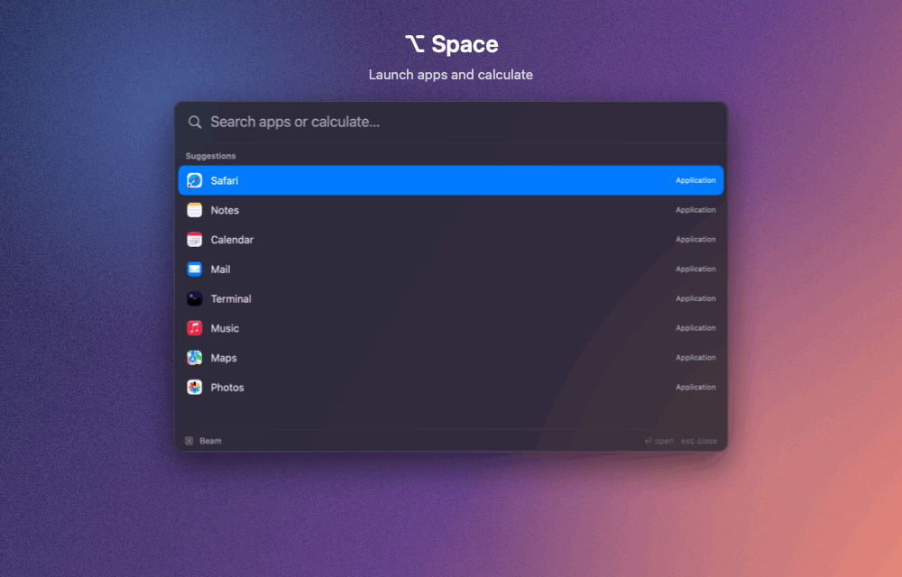

# Beam

*Every window, one keystroke away.*

**Window switcher + productivity tool for macOS.** 
Jump to any window, launch apps, find files and calculate — from the keyboard.

[**Download**](https://github.com/awaismemon26/beam-macos/releases/latest) · [Features](#features) ·
[Install](#install) · [Shortcuts](#shortcuts)

 

## Features

- **⌃ Tab — switch windows of the current app.** Hold Control, tap Tab, release to jump. Works across Desktops
  and brings back minimized windows.
- **⌥ Tab — search every window** by app name (`chrome`, `vscode`) or title (`invoice`), on any Desktop.
- **Bundles.** Group a project's windows and files, then open or bring them all forward from ⌥ Tab. Windows of
  apps that show the document or folder in their title (VS Code, Office, Preview, Finder) rejoin automatically
  after a restart.
- **⌥ Space — launcher** with fuzzy app search that learns what you use most.
- **File search.** Type `f invoice` in the launcher to find files by name in the folders you choose. Off until
  you turn it on.
- **Calculator.** `5 % of 5000`, `100 usd in eur`, `3pm london in tokyo` — the answer appears as you type.
- **Search history.** Press ↑ in an empty search field to bring back earlier searches.
- **Your shortcuts, your settings.** Rebind every hotkey, choose which screen Beam opens on, open at login, light
  or dark.
- **Native and light.** No web views, no account, no telemetry. Idles at ~0% CPU and about 50 MB of memory.

## Install

1. Download **`Beam-<version>.zip`** from the [latest release](https://github.com/awaismemon26/beam-macos/releases/latest),
   unzip it and drag **Beam.app** into **Applications**.
2. Open Beam. The first time, macOS can't verify it (Beam isn't notarized yet): open
   **System Settings ▸ Privacy & Security** and click **Open Anyway**.
3. Turn on **Accessibility** for Beam when asked. That's it.

Updates keep the Accessibility permission. Coming from 1.0.0, grant it once more.

**Requirements:** macOS 15 or later, Apple silicon or Intel.
**Using Raycast or Alfred?** Change Beam's launcher hotkey in **Settings ▸ Shortcuts**, or free ⌥ Space there.

## Shortcuts

Defaults — change any of them in **Settings ▸ Shortcuts**.

| Shortcut | Action |
|---|---|
| <kbd>⌃</kbd> <kbd>Tab</kbd> | Windows of the current app — release <kbd>⌃</kbd> to jump, <kbd>Esc</kbd> to cancel |
| <kbd>⌥</kbd> <kbd>Tab</kbd> | Search bundles and windows |
| <kbd>⌥</kbd> <kbd>Space</kbd> | Launcher, calculator and file search |

Inside the panels: <kbd>⏎</kbd> open · <kbd>⌘</kbd> <kbd>⏎</kbd> bring a bundle forward or open a file ·
<kbd>⌘</kbd> <kbd>G</kbd> add to a bundle · <kbd>↑</kbd> earlier searches · <kbd>⌘</kbd> <kbd>,</kbd> Settings.

## Privacy

Beam needs **Accessibility** to see and switch windows. File search uses macOS's Spotlight index for file names
only; macOS may ask once for folder access when you turn it on. Nothing you search or group leaves your Mac — the
only network request is for currency exchange rates.

## Build from source

`Tools/install.sh` builds and installs Beam (needs Xcode 26+ and `brew install xcodegen`). See
[CONTRIBUTING.md](CONTRIBUTING.md) for development and tests, and [CHANGELOG.md](CHANGELOG.md) for release history.

## License and credits

[MIT](LICENSE). Calculator powered by [SoulverCore](https://github.com/soulverteam/SoulverCore). Reaching windows on
other Desktops follows the technique documented by [AltTab](https://github.com/lwouis/alt-tab-macos).
